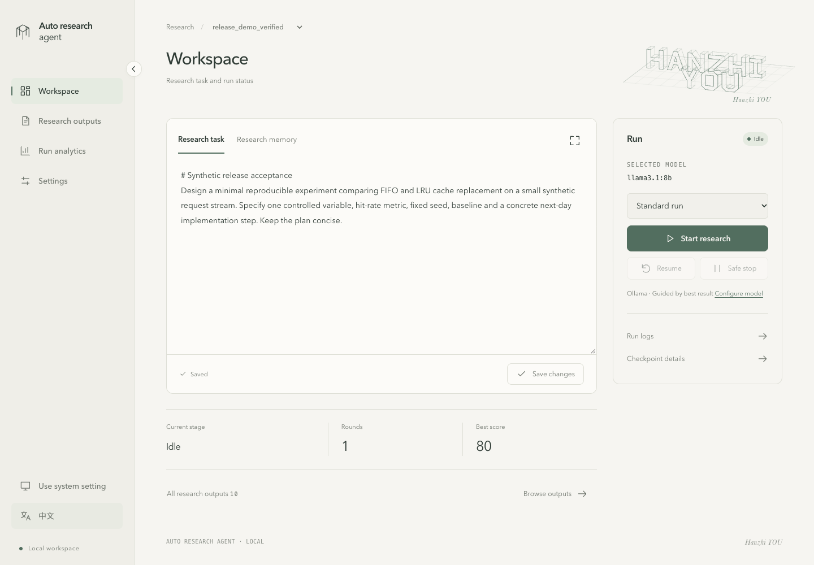

# Auto Research Agent

[English](README.md) · [简体中文](README.zh-CN.md)

**A local-first workspace for turning a research task into drafts you can inspect, revise, and compare.**

Auto Research Agent runs **Draft → Review → Revise → Judge** with local Ollama or Google Gemini. A local dashboard keeps the task, progress, saved outputs, and run comparisons together. Model scores support iteration; they do not establish research validity.

**For users:** start with the [user README](docs/user/README.md).

**For agents:** read [AGENTS.md](AGENTS.md), then the [agent README](docs/agent/README.md).



*The local dashboard, showing a synthetic demo task. Scores are model feedback, not research validation.*

## Three steps

1. **Define a task.** Use the public example or create a separate project under `projects/`.
2. **Run and inspect.** Start the dashboard, choose a provider and model, and review each saved round.
3. **Continue with context.** Resume a valid checkpoint, inspect outputs, or compare runs before deciding what to try next.

## Start locally

Use Python **3.10+**, Git, and Make. Run these commands in a new checkout:

```bash
git clone https://github.com/ThineLord/auto-research-agent.git
cd auto-research-agent
cp config.example.yaml config.yaml
make install
make ui
```

Open **[http://127.0.0.1:8501/](http://127.0.0.1:8501/)** and keep the server running. In an existing checkout, reuse its configuration and environment. Starting the dashboard does not start a research run. Real runs need a configured provider; `make mock` demonstrates saved outputs without model calls. See the [user guide](docs/user/README.md) before running a real task.

## Explore the repository

| Build and run | Learn and maintain |
| --- | --- |
| [Workflow](src/) · [Dashboard](ui/) · [Prompts](prompts/) | [User guide](docs/user/README.md) · [Documentation](docs/README.md) |
| [Example project](projects/example/) · [Tests](tests/) | [Agent guide](docs/agent/README.md) · [Tools](scripts/) |

Local configuration, credentials, generated runs, and private projects stay out of Git by default. Gemini sends model inputs to its cloud provider when selected.

## Versions and documentation

Current version: **0.2.2**. Releases use `vMAJOR.MINOR.PATCH` tags matched to `pyproject.toml`. Historical milestone tags remain available. Application releases and saved research artifacts have separate compatibility boundaries.

- [Releases](https://github.com/ThineLord/auto-research-agent/releases) · [0.2.2 notes](docs/releases/0.2.2.md) · [Changelog](CHANGELOG.md)
- [User README](docs/user/README.md) · [Agent README](docs/agent/README.md)
- [Documentation map](docs/README.md) · [Version and release policy](docs/agent/releases.md)

The dashboard runs from a source checkout. The installable Python package provides the CLI and bundled starter resources.
