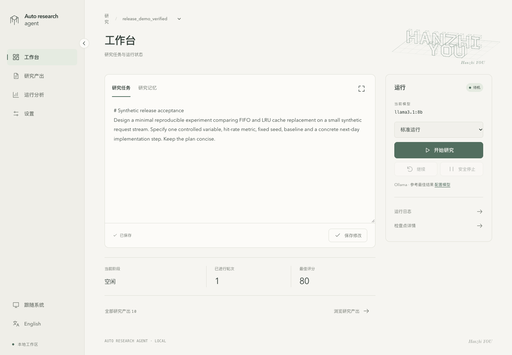

# Auto Research Agent

[English](README.md) · [简体中文](README.zh-CN.md)

**一个以本地工作区为中心的研究助手：把研究任务变成可检查、可修改、可比较的草稿。**

项目使用本地 Ollama 或 Google Gemini 执行 **起草 → 审查 → 修改 → 评分**，通过本地网页集中查看任务、进度、已保存成果和运行对比。模型评分帮助迭代，不代表研究结论已经得到验证。

**用户入口：**阅读[用户 README](app/docs/user/README.zh-CN.md)。

**Agent 入口：**先读 [AGENTS.md](AGENTS.md)，再读 [Agent README](app/docs/agent/README.zh-CN.md)。



*本地工作台，展示公开演示任务。评分是模型反馈，不代表研究结论已经验证。*

## 三步使用

1. **写下任务。**使用公开示例，或在 `app/` 同级建立独立研究项目。
2. **运行并检查。**打开工作台，选择模型来源和模型，查看每一轮保存的结果。
3. **带着上下文继续。**恢复有效检查点、浏览成果、比较运行记录，再决定下一步。

## 本地启动

需要 Python **3.10+**、Git 和 Make。首次克隆后执行：

```bash
git clone https://github.com/ThineLord/auto-research-agent.git
cd auto-research-agent
./start
```

打开 **[http://127.0.0.1:8501/](http://127.0.0.1:8501/)**，使用期间保持服务运行。已有项目请复用原有配置和环境。打开工作台不会自动开始研究；真实运行需要配置模型来源，`make mock` 可在不调用模型的情况下演示成果保存。运行实际任务前请阅读[用户指南](app/docs/user/README.zh-CN.md)。

## 你的工作区

```text
auto-research-agent/
├── app/                 程序、依赖、测试和维护文档
├── example/             公开示例研究
├── projects/example/    仅保留旧 Git 升级所需的任务兼容文件
├── research-topic-a/    网页中新建的研究方向
├── research-topic-b/    另一个独立研究方向
├── README.md
└── start                安装所需依赖并启动工作台
```

点击研究选择器旁的 **+**，输入文件夹名和研究任务即可创建；通过同一选择器切换。数据和上次选择在重启后保留。配置保存在被 Git 忽略的工作区 `config.yaml` 中，新研究目录默认不进入 Git。

旧版 `projects/<name>/` 仍在原位加载，不会自动迁移。升级前阅读[安全升级与回滚指南](app/docs/user/workspace-upgrade.zh-CN.md)。[应用文档](app/docs/README.md) · [Agent 指南](app/docs/agent/README.zh-CN.md)

## 版本与文档

当前版本：**0.3.0**。发布使用 `v主版本.次版本.修订版本` 标签，与 `pyproject.toml` 保持一致，历史里程碑标签保留。应用版本与研究产物的数据兼容边界分别管理。

- [版本发布](https://github.com/ThineLord/auto-research-agent/releases) · [0.3.0 更新说明](app/docs/releases/0.3.0.zh-CN.md) · [变更记录](app/CHANGELOG.md)
- [用户 README](app/docs/user/README.zh-CN.md) · [Agent README](app/docs/agent/README.zh-CN.md)
- [文档导航](app/docs/README.md) · [版本与发布规则](app/docs/agent/releases.zh-CN.md)

网页工作台通过源码仓库运行；可安装的 Python 包提供命令行程序和内置入门资源。
